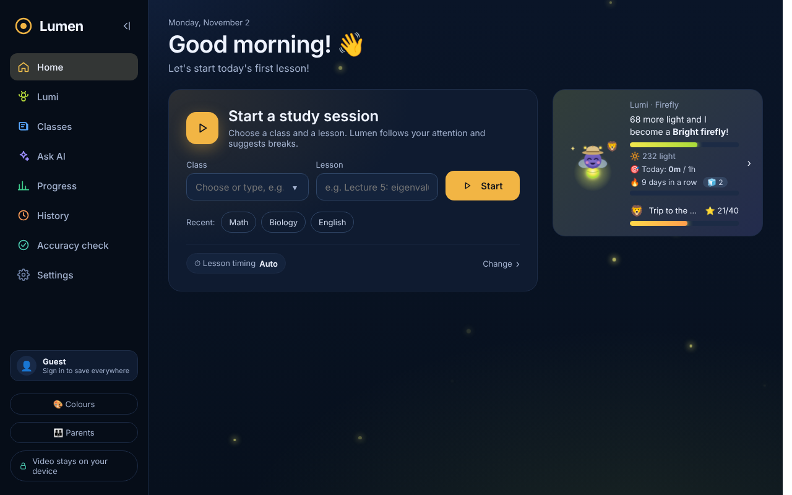
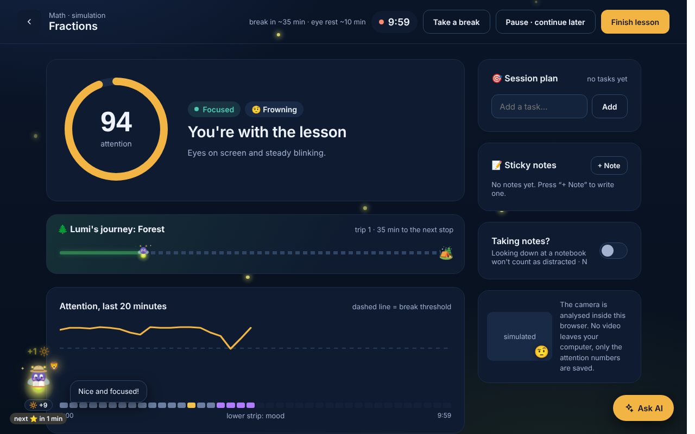
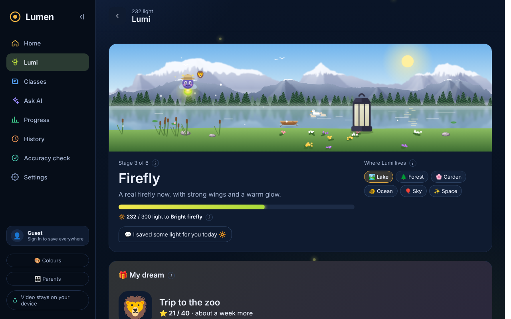
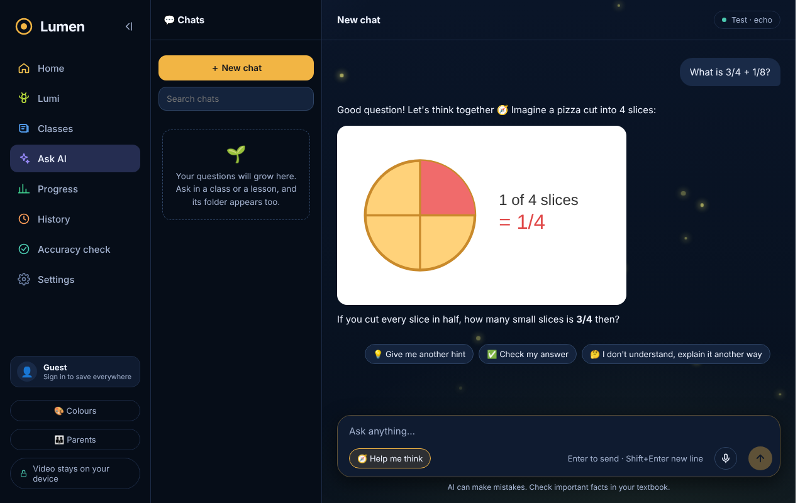

# ◎ Lumen

**A study and focus coach for children, right in the browser.**
Lumen helps kids do their homework with focus: it notices when attention drifts, suggests breaks at the right
moment, and turns study time into light for **Lumi**, a little firefly that grows with every focused minute.

👉 **Try it:** [inesa07.github.io/Lumen](https://inesa07.github.io/Lumen/) · free, no installation



## What Lumen does

### 🎯 Focus lessons
The child starts a lesson, and Lumen follows attention through the webcam: eyes on the screen, the phone in
hand, tiredness (blinks, yawns) and mood. It suggests a break before attention drops and reminds about eye rest.
Lumi sits next to the child and reads its own book while they focus.



### 🪲 Lumi, the study friend
- Every focused minute gives Lumi **light 🔆**. With enough light Lumi grows (6 stages) and unlocks outfits.
- Lumi lives in a little world the child chooses: a lake, a forest, a garden, the ocean, the sky or space,
  with day and night, seasons, weather and holidays.
- Lumi misses the child after a few days without lessons, falls asleep after three, and is happy when they come back.



### ⭐ My dream
The child talks with their parents and writes a dream (for example, "a trip to the zoo").
Lumen counts how many stars it needs, fairly for how this child usually studies. Stars come from focused
lessons, and Lumi changes on the way to the dream: at 25 %, 50 % and 75 %, and a celebration at the end.

### 🧭 An AI tutor that helps to think
The AI tutor doesn't give ready answers to homework. It asks guiding questions and gives one small hint at a
time, so the child solves the task themselves. It can draw a simple picture to explain an idea, help plan an
essay without writing it, and children can ask with their voice.



### 🔥 Day streak with freezes
Studying a little every day builds a streak. A missed day uses a 🧊 freeze automatically, so one bad day
doesn't take everything away.

### 👪 For parents
A parent mode protected by a PIN: progress, a short weekly report by email, the dream, and control over the
AI tutor (for example, hints only).

### 🖥️ Everywhere
A Mac desktop widget with Lumi's world, the dream and today's goal; "Lumen mini" as a small window;
English, Russian and Armenian.

## 🔒 Privacy first

The camera is processed **on the child's own computer**, inside the browser. Video and photos are never
uploaded or saved. Only numbers like "45 minutes, 82 % focus" are kept. Lessons are stored in the browser,
or in the child's account when they sign in.

## How it works

| Part | Technology |
|---|---|
| Face, eyes, head direction, expressions | MediaPipe Face Landmarker (WebAssembly, on the device) |
| Phone detection | EfficientDet-Lite0 object detection |
| Attention, tiredness, mood, breaks | a tracker that compares the signals with the child's own calm baseline |
| App | plain JavaScript modules, no build step |
| Data | IndexedDB in the browser, offline-first sync with Supabase (PostgreSQL with Row Level Security) |
| AI tutor | Gemini through a Supabase Edge Function (the key stays on the server) |
| Hosting | GitHub Pages |

## Run it locally

No build step and no `npm install` needed.

```bash
python3 -m http.server 5173
# open http://localhost:5173/
```

The camera works on `https://` or `http://localhost`.
Add `?fake=1` to the address to try it with a simulated student instead of a camera.

Tests: `node --test`

## Project structure

```
index.html            the app
src/vision/           camera and MediaPipe, plus a simulated student
src/core/             the tracker, statistics, Lumi, the dream and the AI tutor
src/data/             browser storage and cloud sync
src/server/           the app's API, running inside the browser tab
static/               pages, styles and Lumi's drawings
desktop-widget/       the Mac widget (Übersicht)
supabase/             database schema and server functions
tests/                unit tests
docs/                 notes on accounts, the AI tutor and the roadmap
```

---

Made by **Inesa Sargsyan** · [inesa07.github.io/Lumen](https://inesa07.github.io/Lumen/)
